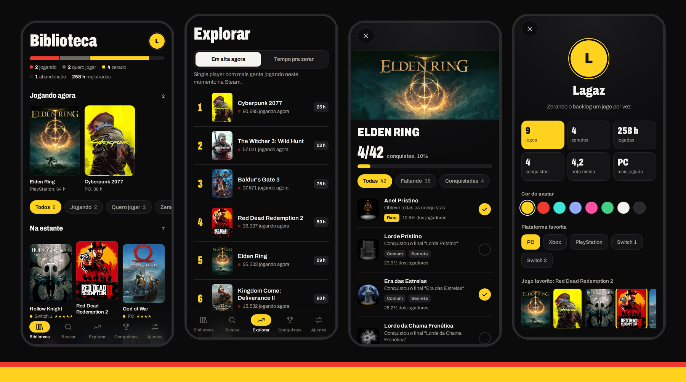
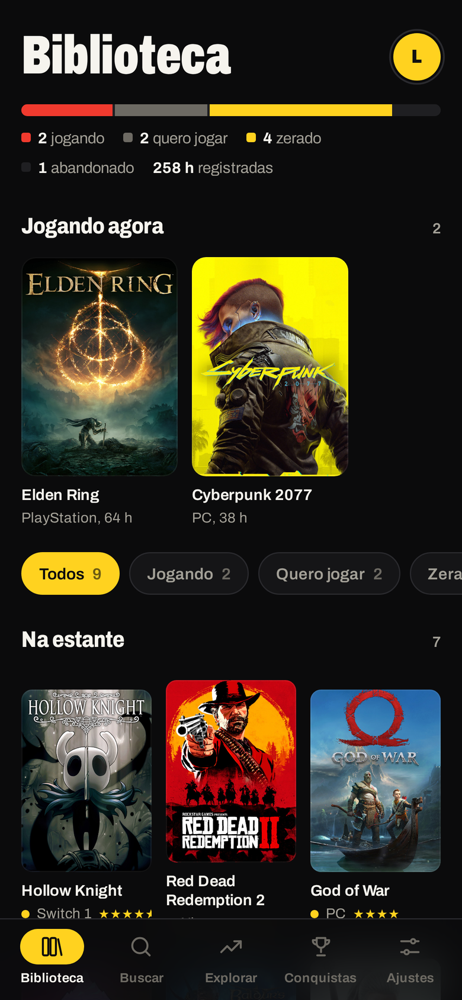
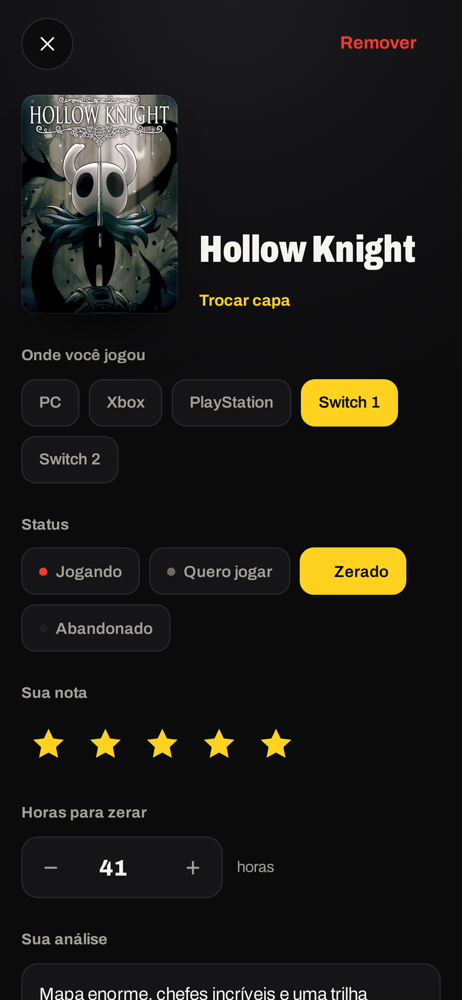
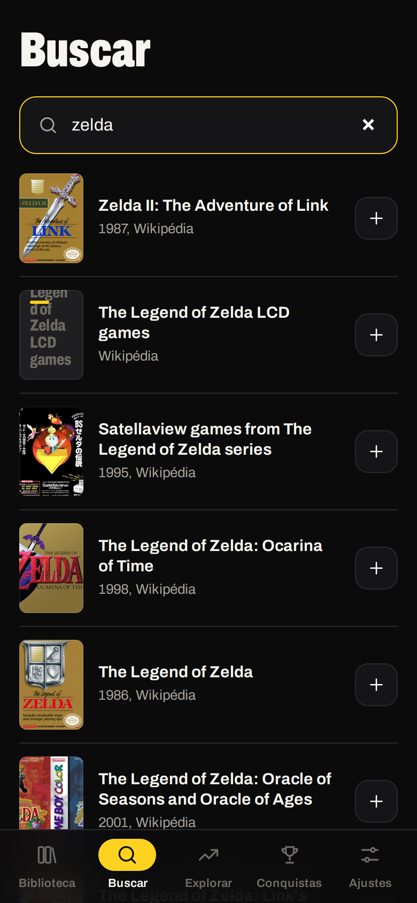
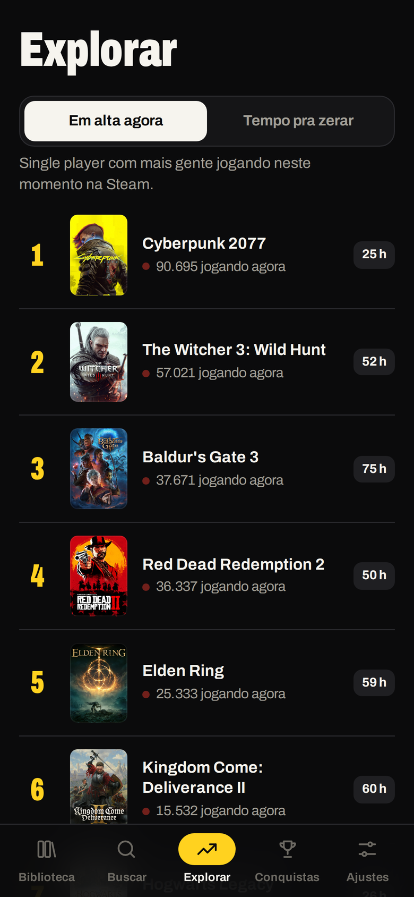
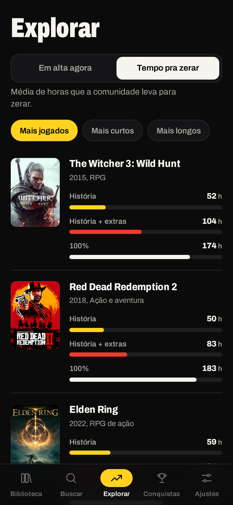
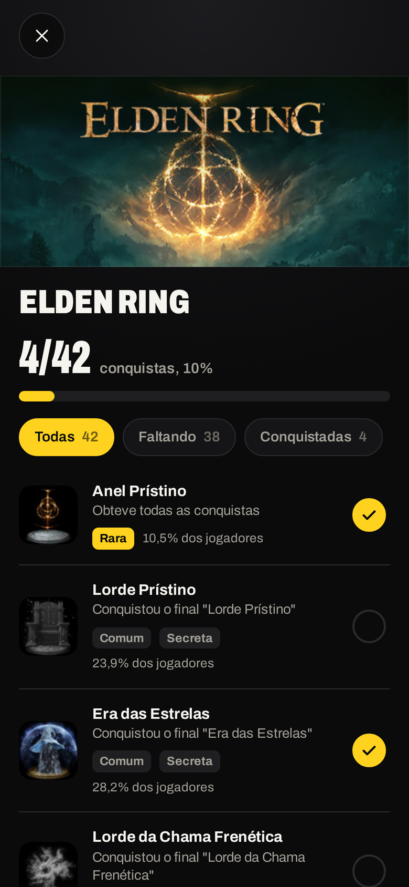
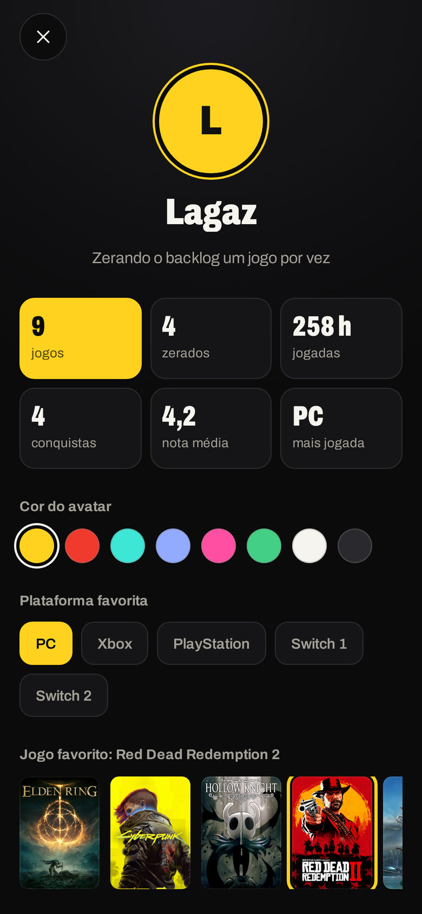
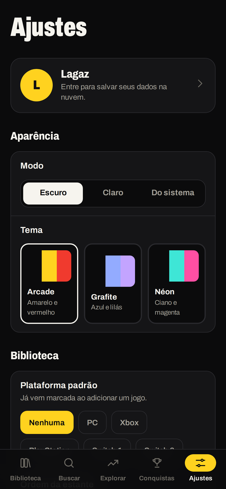
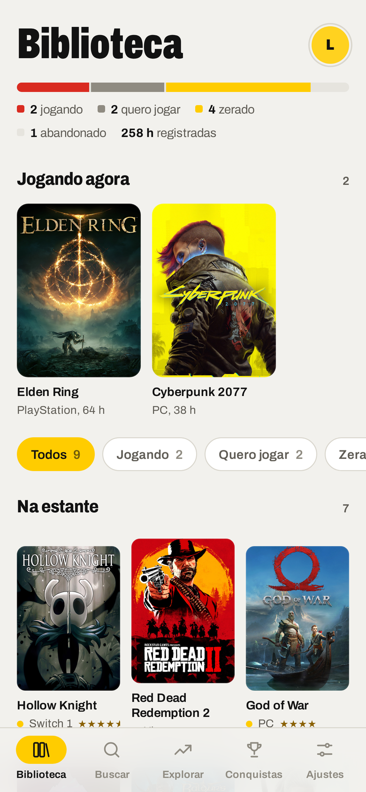

# 🎮 Zerei

**Aquele app pra você parar de mentir que vai zerar todos os jogos que comprou na promoção.**

Organize sua pilha de jogos, dê nota, escreva o que achou, veja quanto tempo leva pra zerar e cace conquistas, tudo no celular.

---

## 🤔 Que app é esse?

Sabe aquela biblioteca na Steam com 300 jogos e você jogando o mesmo de sempre? Pois é.
O **Zerei** é um diário de jogos: você anota o que está jogando, o que quer jogar, o que zerou e o que largou no meio (sem julgamentos 👀).

Feito pelo canal **Lagaz**, pra quem leva a sério essa coisa de "um dia eu zero".

## ✨ O que ele faz

| | |
|---|---|
| 🗂️ **Biblioteca com capas de verdade** | Busca qualquer jogo pelo nome e o app baixa a capa certinha (Wikipédia + Steam). Ficou errada? Toca em *Trocar capa* e escolhe outra. As capas ficam salvas no celular e aparecem até sem internet. |
| 🕹️ **Plataforma em que você jogou** | PC, Xbox, PlayStation, Switch 1 ou Switch 2. |
| ⭐ **Nota e análise** | De 1 a 5 estrelas, mais um espaço pra escrever o que achou da história, do final, daquele chefe maldito… |
| ⏱️ **Quantas horas levou** | Anota suas horas e o app compara com a média: "você zerou 8 h abaixo da média", essas coisas. |
| 📊 **Tempo pra zerar** | Milhares de jogos com o tempo médio de *História*, *História + extras* e *100%*, puxados do HowLongToBeat. Filtra por duração e plataforma, busca qualquer jogo e rola sem fim. |
| 🔥 **Em alta agora** | Os jogos single player mais jogados da Steam neste momento, com número ao vivo, sem limite: é só ir rolando. |
| 🏆 **Rastreador de conquistas** | Pesquisa um jogo da Steam e vê todas as conquistas (em português!), quantos % dos jogadores têm cada uma, quais são raras e secretas. Vai marcando as que você fez e acompanha o progresso. |
| 🎲 **Roleta** | Não sabe o que jogar? Diz quanto tempo tem (até 10 h, 10 a 30 h…) e o app sorteia um jogo da sua lista, ou qualquer jogo do mundo. |
| 🗂️ **Estante por plataforma** | Jogos separados em blocos de PC, PlayStation, Xbox e Switch, com um selo discreto em cada capa. |
| 🔃 **Puxar para atualizar** | Arrasta a tela pra baixo e a página recarrega. |
| 🎯 **Metas do ano** | "Zerar 12 jogos em 2026", com barra de progresso, ritmo ("você está 2 à frente") e gráfico por mês. |
| 🕰️ **Linha do tempo** | Toda a história da sua estante: quando começou, zerou, largou ou avaliou cada jogo. |
| 📸 **Cartão de compartilhar** | Gera uma imagem bonita do jogo (capa, nota, horas e sua análise) ou da sua meta, pronta pros Stories ou pro feed. |
| 🌐 **Rede** | Perfis públicos com @, avaliações de outras pessoas, seguir, curtir, média da rede para cada jogo, spoiler escondido, denunciar e bloquear. Você escolhe o que publica. |
| 👤 **Perfil** | Nome, frase, cor do avatar, plataforma e jogo favoritos, e as suas estatísticas: jogos, zerados, horas, conquistas, nota média. |
| 🔗 **Steam, Xbox e PlayStation** | Conecta suas contas e o app puxa seus jogos, as horas jogadas e o progresso de conquistas e troféus direto pra biblioteca. Sua nota e análise não são mexidas. |
| 🔄 **Atualiza sozinho** | O app avisa (ou já baixa) quando sai versão nova. Também tem o botão *Buscar atualizações*. |
| ☁️ **Perfil offline ou conta** | Usa offline, tudo no celular, ou entra com Google pra salvar na nuvem (o login com Google está chegando). |
| 🎨 **Temas** | Modo escuro, claro ou do sistema, e três temas: **Arcade** (amarelo, vermelho e preto), **Grafite** e **Néon**. |
| 💾 **Backup** | Exporta e importa sua biblioteca quando quiser. |

## 📱 Por dentro

<table>
  <tr>
    <td align="center"> <b>Biblioteca</b></td>
    <td align="center"> <b>Ficha do jogo</b></td>
    <td align="center"> <b>Busca com capas</b></td>
  </tr>
  <tr>
    <td align="center"> <b>Em alta agora</b></td>
    <td align="center"> <b>Tempo pra zerar</b></td>
    <td align="center"> <b>Conquistas</b></td>
  </tr>
  <tr>
    <td align="center"> <b>Perfil</b></td>
    <td align="center"> <b>Ajustes e temas</b></td>
    <td align="center"> <b>Modo claro</b></td>
  </tr>
</table>

## 📥 Como instalar

1. Abre a página de **[Releases](https://github.com/LagazYT/backlog-jogos/releases/latest)** pelo celular.
2. Baixa o arquivo **`Zerei.apk`**.
3. Toca nele. O Android vai perguntar se pode instalar apps dessa fonte, é só permitir.
4. Pronto, bora organizar esse backlog. 🎉

> Atualizou? Instala a versão nova por cima, sua biblioteca continua lá.

## 🧩 De onde vêm os dados

- **Capas e busca:** Wikipédia (cobre todas as plataformas, até Nintendo) e loja da Steam.
- **Jogadores agora e conquistas:** serviços públicos da Steam. Por isso conquistas e o ranking *Em alta* só valem pra jogos que estão na Steam.
- **Tempo pra zerar:** médias aproximadas da comunidade, guardadas em [`data.js`](app/src/main/assets/www/data.js). Quer adicionar um jogo? Manda um PR!
- **Contas de jogos:** você só faz login no site oficial de cada plataforma, dentro do app. Sem chave, sem cadastro extra.
  - *Steam:* jogos, horas e conquistas (os detalhes de jogos precisam estar públicos no perfil).
  - *Xbox:* login com a conta Microsoft, lendo jogos, horas e conquistas direto do Xbox Live.
  - *PlayStation:* login na PSN, lendo jogos de PS4/PS5, horas e troféus.
  - O app nunca vê sua senha, e o acesso fica só no seu celular.
- **Sua conta (opcional):** Firebase (login e banco de dados). Cada pessoa só consegue ler e escrever os próprios dados.

---

Feito com 💛❤️🖤 por **Lagaz**. Se curtiu, deixa uma ⭐ aqui no repositório!

